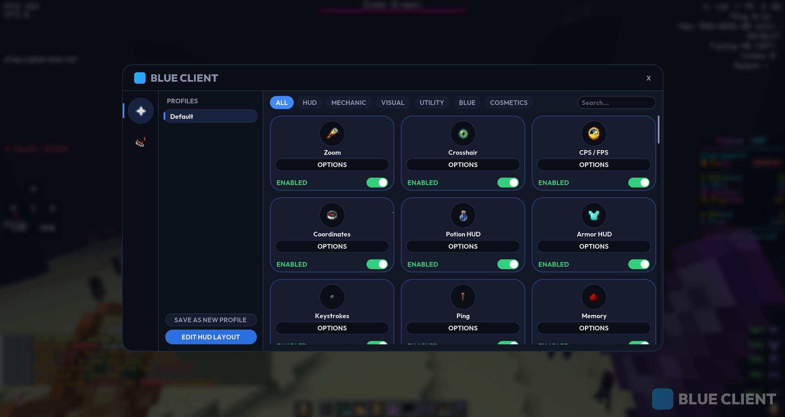
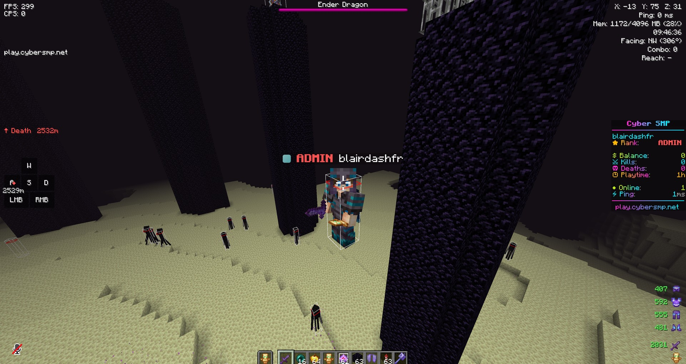

# Blue Client

A lightweight, ad-free client-side mod for Minecraft: Java Edition. Blue Client adds a clean HUD, a Click GUI and quality-of-life modules without the clutter.

Download it from [Modrinth](https://modrinth.com/mod/blueclient).




## Features

- **Click GUI** with every module sorted into HUD, Mechanic, Visual, Utility, Blue and Cosmetics tabs. Toggle a module, open its options, search, and save your setup as a profile.
- **HUD editor** (Edit HUD Layout) to drag every element where you want it.
- **HUD modules:** CPS / FPS, Keystrokes, Coordinates, Ping, Memory, Potion HUD, Armor HUD, combo and reach counters, and more.
- **Zoom** and a configurable **Crosshair**.
- **Cosmetics** such as the Blue Client capes.
- Works on multiplayer servers. It is display-only and does not automate gameplay.

## Supported versions

| Source tree | Minecraft versions | Loader |
| --- | --- | --- |
| `versions/` + `groups/yarn` | 1.20.1, 1.20.4, 1.20.6, 1.21.4, 1.21.7, 1.21.11 | Fabric |
| `versions/` + `groups/mojmap` | 26.1, 26.1.1, 26.1.2, 26.2, 26.3, 26.4 | Fabric |
| `legacy/1.8.9` | 1.8.9 | Forge |

Fabric API is required on Fabric. Forge, NeoForge and Quilt builds are published on Modrinth; their build trees are not part of this repository yet.

## Building

One source tree covers every Fabric version:

```
groups/yarn/src                    shared code for 1.21.x (Yarn names, remapping Loom)
groups/mojmap/src                  shared code for 26.x (Mojang names, unobfuscated)
versions/<mc>/src                  files that differ for that version (they replace the group copy)
versions/<mc>/exclude.txt          group files that do not exist for that version
versions/<mc>/version.properties   Minecraft / Fabric API / loader versions
shared-patches/                    text patches shared by several versions
```

Requirements: JDK 25 (JDK 21 for the 1.20.x and 1.21.x targets).

```
.\build.ps1                    # build every version
.\build.ps1 -Version 26.3      # build one version
gradlew -Pmc=26.3 build        # same thing, directly
```

Each version builds into `build/<mc>/`, and `build.ps1` collects the jars in `dist/`.

To add a version, create `versions/<mc>/version.properties` (copy a neighbouring one) and put any differing files under `versions/<mc>/src/`. To fix a bug for every version, edit the file in `groups/<group>/src` and any `versions/*/src` copy of it.

## License

Copyright (c) 2026 blairdash. All rights reserved. The source is published so you can read it; you may not copy, redistribute or reuse it without permission. See [LICENSE](LICENSE). The Outfit font is licensed under the SIL Open Font License, see [licenses/OFL-Outfit.txt](licenses/OFL-Outfit.txt).

Blue Client is not an official Minecraft product. It is not approved by or associated with Mojang or Microsoft.